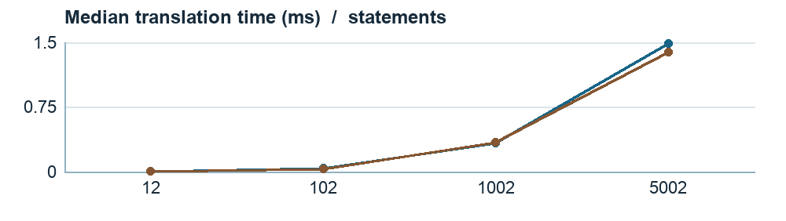

# Q7 Stages 1 and 2 Design Alternatives

The brief asks for independent proposals from two students. The two initial designs below are worked alternatives for the combined submission. They represent two evaluation strategies, without attributing a separate collaboration or viva to either student.

### Initial design A Predictive translation

```text
P → Decl* Stmt*
Decl → Type id ( , id )* ;
Stmt → id = Expr ; | if ( Rel ) Block else Block | while ( Rel ) Block
Expr → Term ( (+ | -) Term )*; Term → Atom ( (* | /) Atom )*
```

Use inherited environment context for a declaration and left-fold accumulator for expressions. Each expression synthesizes type, address and AST. After a type, apply it to each name; after each factor or term, fold into the left tree. At if entry allocate true, false and join labels, pass the branch labels to Rel, and emit the arms in source order. Run actions during predictive parsing. This keeps translation local but requires care with partial output and recovery.

### Initial design B Parse then translate

```text
Program → DeclList StmtList
Decl → Type NameList ;
Stmt → Assign | IfElse | While
Assign → id = Expr ;
IfElse → if ( Expr rel Expr ) Block else Block
```

Synthesize a structural AST while parsing. In a later traversal, declaration nodes populate a symbol table, expression nodes return type/address pairs and IfElse lowers children with inherited branch targets. For code, use a shared append buffer rather than concatenate strings at every AST node. This makes syntax failure easy to isolate and suits tooling that needs the tree, but visits the AST again.

### Comparison and decision

| Issue | A and B comparison | Retained choice |
| --- | --- | --- |
| Grammar | Both use distinct statement starts and a precedence grammar. Braces prevent dangling else. | Predictive grammar; left folds preserve associativity. |
| Attribute timing | A computes locally during parsing; B defers to an AST traversal. | A as translator; B as comparison baseline. |
| Types and scope | Both need explicit coercion, redeclaration and visibility policies. | One file scope; int widens to float; no narrowing. |
| Errors | A can produce intermediate output before syntax is known to be valid; B separates syntax. | Hold output in memory, reject malformed syntax, suppress TAC if semantic errors exist. |

## Q7 Stage 3 Grammar and Attributes

MiniLang accepts declarations before statements, including empty sequences. Every if has an else. The expression grammar is predictive: the loops in E and T are left folds, equivalent to inherited accumulators on right-recursive tail productions. Braces delimit statement lists, and declarations are file scope only.

```text
P     → Decl* Stmt*
Decl  → Type Names ;
Type  → int | float
Names → id ( , id )*
Stmt  → id = E ; | if ( B ) Block else Block | while ( B ) Block
Block → { Stmt* }
B     → E rel E
rel   → < | <= | > | >= | == | !=
E     → T ( (+ | -) T )*
T     → F ( (* | /) F )*
F     → ( E ) | id | num
```

| Symbol or state | Direction and type | Purpose |
| --- | --- | --- |
| Type.type | Synthesized enum | Declared type int or float. |
| Names.in | Inherited enum | Shared type passed from Type; applied to each name. |
| Names.ids | Synthesized list | Ordered identifiers, used at declaration completion. |
| Decl and Stmt env | Inherited input; synthesized result | Thread the file scope map through declarations; statements read it. The code uses one mutable map in source order. |
| E, T, F result | Synthesized triple | AST reference, int/float/error type and TAC address. |
| E and T tail acc | Inherited triple | Completed left operand at each loop iteration. |
| B.true, B.false | Inherited labels | Where a relational condition sends control. |
| If join, while head and exit | Local labels | Allocated before lowering children. No global search. |
| AST and effects | Synthesized tree; ordered stream | Children build a parent node; effects append TAC instructions or diagnostics. |

A symbol table maps identifier strings to their declared types. On a duplicate, the first type is kept. Unbound uses synthesize an error type and dependent arithmetic avoids cascading diagnostics. The C parser stops at the first syntax mismatch and reports semantic diagnostics in source order for syntactically valid programs. It never returns partially generated TAC as a successful translation.

## Q7 Stage 3 Semantic Actions

| Production | Action and order |
| --- | --- |
| P and Block | Visit declarations or statements left to right, passing the current map. Collect child trees into a program or block. An empty repetition contributes nothing. |
| Type and Names | A type token synthesizes its spelling. Names keeps its identifiers in order. Decl supplies Type.type to the list and installs each id on successful recognition of the semicolon. |
| F → num or id | Literal type follows its spelling and the spelling is its address. An id uses the symbol table for its type and itself for its address. |
| F → ( E ) | Return E’s tree, type and address; parentheses change parsing only. |
| E and T | Seed an accumulator from the first child. For each operator, parse the next operand; promote as required, emit a fresh temporary assignment, and replace the accumulator with the result and binary AST. Return it when the tail ends. |
| Assignment | After the RHS, look up the target and check compatibility. Emit a cast for widening when needed, then a store; create an assignment tree. |
| B and rel | Use the operator spelling. Evaluate both operands, widen if types differ, emit a conditional jump to B.true and an unconditional jump to B.false. |
| if and else | Allocate true, false and join labels. Translate B with branch targets, then true label and first block; jump to join; emit false label and second block, then join. |
| while | Allocate head, body and exit labels. Emit head, translate B with body/exit, emit body label and block, then jump to head and emit exit. |

The result type of +, − and * is float if either operand is float; otherwise int. Division yields float, with integer operands widened. A float assignment to int is rejected. The compiler does not check initialization or division by zero in MiniLang; Q1’s calculator checks zero because it evaluates actual values.

```text
translate(source, mode):
  create symbol map, diagnostics, temporary counter and label counter
  if online: parse and run actions at the points listed above
  else: parse into AST, then walk it left to right with the same actions
  if semantic errors: return annotated tree and symbols, withhold TAC
  otherwise: return annotated tree, symbols and instructions
```

## Q7 Stage 4 Annotated Program Tree

The example contains seven top-level constructs (including two declarations) and eight assignment/control statements counting nested statements. The concrete derivation below groups repeated or unit productions and includes every source token. A slash inside an expression annotation separates type from address, not a division operator.

```text
P
├─ Decl(Type(int), Names(id(x):int , id(y):int), ;)
├─ Decl(Type(float), Names(id(z):float), ;)
├─ Stmt(id(x):int = E(F(1):int/1) ;)
├─ Stmt(id(y):int = E(T(F(x):int/x) + T(F(2):int/2)):int/%t1 ;)
├─ Stmt if ( B[L1,L2](E(y):int/y > E(2):int/2) )
│  ├─ Block { Stmt(id(z):float = E(y):int/y ;) } [cast %t2]
│  ├─ else
│  └─ Block { Stmt(id(z):float = E(0.5):float/0.5 ;) } [join L3]
├─ Stmt while ( B[L5,L6](E(x):int/x < E(y):int/y) ) [head L4]
│  └─ Block { Stmt(id(x):int = E(x + 1):int/%t3 ;) }
└─ Stmt(id(z):float = E(z + x):float/%t5 ;) [cast x → %t4]
```

Program output contains the full annotated AST and symbol table x:int, y:int, z:float. Selected attributes from that output are included above. The exact three-address code follows; the two columns are consecutive blocks.

```text
x = 1                              L4:
%t1 = x + 2                        if x < y goto L5
y = %t1                            goto L6
if y > 2 goto L1                   L5:
goto L2                            %t3 = x + 1
L1:                                x = %t3
%t2 = intToFloat y                 goto L4
z = %t2                            L6:
goto L3                            %t4 = intToFloat x
L2:                                %t5 = z + %t4
z = 0.5                            z = %t5
L3:
```

Execution in the test interpreter reaches x = 3, y = 3 and z = 6.0. The first condition takes the true arm; the loop increments x until it equals y.

## Q7 Stage 4 Formal Dependency Graph

The drawing below instantiates the dependencies for the entire example. A bracketed label groups the local attributes of one subtree. Syntax leaves such as punctuation have no semantic dependencies. Arrows always point from prerequisites to results.

```text
int → Names₁.in → bind(x), bind(y) ─▶ Γ₁
float → Names₂.in → bind(z); Γ₁ + bind(z) ─▶ Γ₂

Γ₂ + [literal 1] ─▶ [A₁: lookup x, check, set x]
Γ₂ + [id x] + [literal 2] ─▶ [ADD₁: int,%t1]
Γ₂ + ADD₁ ─▶ [A₂: lookup y, check, set y]

IF allocator ─▶ [L1,L2] ─▶ B₁.in
Γ₂ + [id y] + [literal 2] + B₁.in ─▶ B₁.branches
Γ₂ + [id y] ─▶ [cast %t2] ─▶ [A₃: set z]
Γ₂ + [literal 0.5] ─▶ [A₄: set z]
B₁.branches + A₃ + A₄ + IF allocator(L1,L2,L3) ─▶ IF.out

WHILE allocator ─▶ [L5,L6] ─▶ B₂.in
Γ₂ + [id x] + [id y] + B₂.in ─▶ B₂.branches
Γ₂ + [id x] + [literal 1] ─▶ [ADD₂: int,%t3] ─▶ [A₅: set x]
B₂.branches + A₅ + WHILE allocator(L4,L5,L6) ─▶ WHILE.out

Γ₂ + [id x] ─▶ [cast %t4]; Γ₂ + [id z] + cast ─▶ [ADD₃: float,%t5]
Γ₂ + ADD₃ ─▶ [A₆: set z]
Γ₂ + A₁ + A₂ + IF.out + WHILE.out + A₆ ─▶ P.out
```

Ordered effects follow bind(x), bind(y), bind(z), A₁, A₂, B₁, A₃, A₄, B₂, A₅, A₆, with control labels and local casts emitted at the points shown in the preceding listing. Γ₂ is the declared type map, not a run-time variable state. The back edge in the generated loop is a TAC control edge; there is no dependency back edge in the compiler.

### Student A classification and complexity

A constructive schedule proves acyclicity: pass the available environment, type or label into each subtree; then evaluate children from left to right; then return the result. No step requires a future sibling or its own result. A tail accumulator uses only the left prefix; types and labels come from the parent or a prior sibling. This makes the dependency design L-attributed and not S-attributed.

With expected constant-time symbol lookup and amortized constant-time append, parsing and translation take expected O(n) time in tokens for bounded token length, or O(source bytes + n) including lexing. Trees, instructions and the symbol table use O(n) space; call depth depends on nesting. The separate pass adds another linear walk. The predictive parser rejects combined block and parenthesis nesting beyond 256 levels. The separate AST walk also uses the C call stack.

## Q7 Stage 4 Experimental Validation

### Student B correctness tests

| Case | Expected and observed | TAC instructions |
| --- | --- | --- |
| Seven top-level constructs | x=3, y=3, z=6.0 | 23 |
| Nested if inside while | x=3, loop terminates | 17 |
| False branch | x=2 | 9 |
| Division with widening | z=1.5 | 4 |
| Narrowing | Reject float assignment to int | 0 |
| Undeclared reads and writes | Report y and z | 0 |
| Duplicate declaration | Two duplicate-x diagnostics | 0 |
| Missing closing parenthesis | Syntax error at semicolon | — |

Both schedules returned identical trees, symbol tables, code and semantic diagnostics on syntactically valid tests; both rejected the malformed input. A small interpreter executed the successful TAC and compared final values with hand-derived expectations.

### Measured comparison

| Statements | Tokens | TAC items | Online ms | Two pass ms |
| --- | --- | --- | --- | --- |
| 12 | 67 | 21 | 0.004 | 0.004 |
| 102 | 607 | 201 | 0.037 | 0.036 |
| 1002 | 6007 | 2001 | 0.328 | 0.337 |
| 5002 | 30007 | 10001 | 1.484 | 1.385 |



Figure 2. Blue: online translation. Brown: parse then walk the AST.

Timings are medians of nine runs per schedule with alternating order, after one comparison warm-up. They include lexing, parsing, annotation and lowering; they exclude memory release, printing and TAC execution. At 30007 tokens, the online and two-pass medians were 1.484 and 1.385 ms. These measurements apply to repeated straight-line assignments on one machine; they do not measure deep nesting, worst-case latency or memory.

## Q7 Stages 5 and 6 Evaluation

### Cross defence

Design perspective: the control-flow tests validate taken and untaken branches and a nested loop. Identical TAC and interpreter results support the correctness of the online schedule, and the timing table measures the cost of the extra walk on one workload. The test cases are evidence for the stated language subset.

Experimental perspective: declarations inherit a type because it comes from the type token outside the identifier list. Conditions inherit labels because their enclosing statement determines the destinations. Expression results synthesize type and address from their operands. Accumulators inherit the already computed left prefix after recursion is removed.

### Designer conclusion

Use syntax-directed translation for this grammar because needed information follows source order and expression structure. The online schedule avoids revisiting the completed AST and keeps type checks close to their source constructs. The measured medians are close, and the separate pass was slightly faster on the largest input in this run. It still stores annotations and buffered TAC; more elaborate mid-rule actions increase parser and recovery complexity. Forward references, mutually recursive declarations, global optimization and analysis across files favor separate passes.

Before choosing a schedule, check whether attributes depend only on children, on earlier context, or on future syntax. Use S-attributed definitions when reductions suffice, L-attributed definitions when left-to-right context is enough, and a separate analysis when nonlocal dependencies dominate. Confirm behavior on malformed input and compare measured costs before removing a useful intermediate tree.

### Contribution record by assignment role

One implementation and report cover both responsibility columns. The table maps evidence to the brief’s roles; it does not assign separate authorship or claim two independent submissions.

| Question | Role A evidence | Role B evidence | Combined evidence |
| --- | --- | --- | --- |
| Q1 | Value proof and height experiment | Instrumented tests and height rules | C parser and SDD |
| Q2 | Type flow and symbol tables | Attribute comparison and errors | Declaration SDD and redesign |
| Q3 | Graphs, orders and cycle | SDD classification and strategies | Generic evaluator |
| Q4 | Tests, counts and refactoring | Action placement and reduction | Verified postfix SDT |
| Q5 | AST rules and inherited fold | Node measurements | Tree and AST output |
| Q6 | LR marker stack | TAC and inherited labels | Cross explanations |
| Q7 | Predictive alternative and proof | Two-pass alternative and tests | MiniLang translator and evaluation |

Viva practice: explain how moving a type after its list changes the attribute flow; why right-sibling dependencies break the L-attributed restriction; and how an inherited accumulator preserves left associativity.
