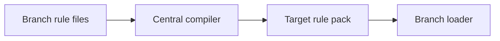

# Task 1 Language Processors

| Processor | How it runs | Fit for ThreatRule |
| --- | --- | --- |
| Compiler | Translates and validates a rule set before execution. | Reject invalid shared rules before deployment and reuse a compiled representation. |
| Interpreter | Reads a representation and dispatches operations at run time. | Easy to prototype; direct interpretation of rule text repeats front end work. |
| Assembler | Maps assembly mnemonics and labels to machine or VM instructions. | Useful only if a backend emits assembly; does not analyze DSL fields or types. |
| Hybrid | Compiles rules to portable bytecode and executes it on a VM. | Useful when branches can host the same VM and need portable rule packages. |

Use an ahead of time compiler at the central SOC. A shared validation policy catches problems before any branch receives the rule. Validated IR can then be translated for each branch platform. A bytecode backend can be added if a shared VM is deployed.

Figure 1. Rule processing and deployment flow.

An optional preprocessor expands controlled includes or macros and preserves source locations; the current scanner assumes neither feature. A linker combines separately compiled rule modules and resolves references if the language later permits them. A loader checks package compatibility and installs validated rules in the branch engine. None of those three optional stages is implemented in the lexical analyzer.
