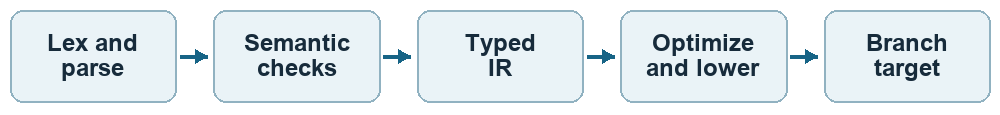

# Task 3 Front End and Back End

Figure 2. The front end ends at typed IR; optimization and target lowering follow.

A common front end gives every branch the same token, grammar and type checks. Only target lowering changes with event schemas or security tools. A phase is a logical job; a pass is a traversal of an input representation. Use two compiler passes: build typed IR from the source, then traverse that IR to optimize and lower it. The scanner itself uses a single stream pass with lookahead.
