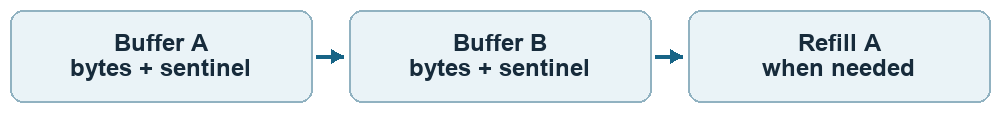

# Task 5 Scanner and Parser Responsibilities

The parser pulls tokens using yylex. A token is a category such as IPV4; its pattern describes dotted decimal syntax and its lexeme is the actual text 10.0.0.5. The scanner removes comments and spacing, maintains line numbers and returns attributes. Identifier attributes reference an intern table. The parser checks token order and nested or repeated grammatical structures independently of character matching.

Figure 3. Conceptual buffer pair. Flex supplies its own generated buffering.

In the classic buffer pair, lexemeBegin marks the start and forward advances to a sentinel. At a buffer boundary, refill the other half and continue; at true EOF, finish the token. This avoids checking a buffer limit after every character. A lexeme may span buffers. The generated scanner handles that crossing without a manual two-buffer implementation.

| Fault from the brief | Diagnostic and recovery |
| --- | --- |
| 10.0.300.5 | Line 1: invalid IPv4. Skip the whole dotted candidate. |
| ALERT "Login failed ; | Line 2: unterminated string. Skip to the line break, which is still counted. |
| port == 22 @ attempts > 5 | Line 3: unexpected character. Skip @ and retain attempts > 5. |
