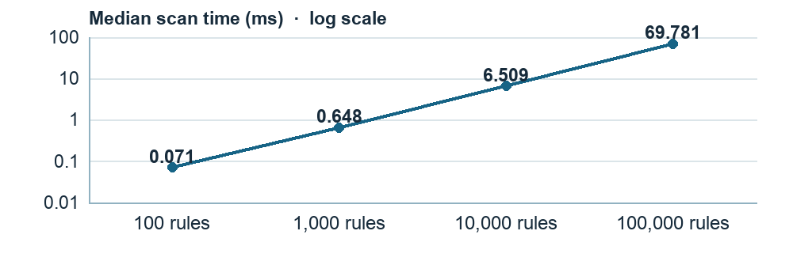

# Task 10 Measured Baseline Performance

Each fixture contains one rule per line, with a unique rule name. Timing covers buffered reads, tokenization, validation, symbol interning and counters. File generation, process startup, token dumps and diagnostic printing are excluded. Each row gives the median of nine runs after one warm-up, with the observed min–max in parentheses.

| Rules and lines | Tokens | Errors | Scan time in ms |
| --- | --- | --- | --- |
| 100 | 1,800 | 0 | 0.071 (0.070–0.072) |
| 1,000 | 18,000 | 0 | 0.648 (0.642–0.655) |
| 10,000 | 180,000 | 0 | 6.509 (6.439–6.546) |
| 100,000 | 1,800,000 | 0 | 69.781 (69.152–71.400) |

Figure 4. The four baseline file sizes on a logarithmic time scale.
