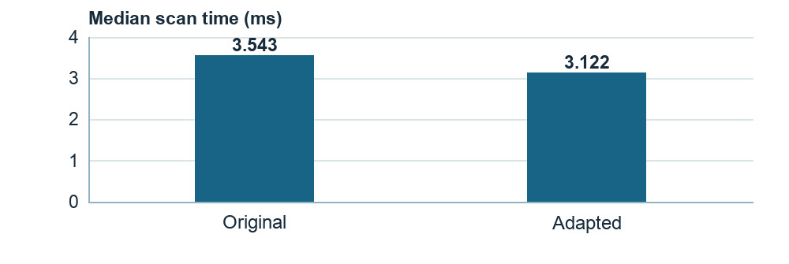

# Task 12 Partner Feed Design

## 12A Impact Analysis

Partner feeds introduce digest, CVE and URL spellings and require continuous line-specific diagnostics. Bare hex digests can also be valid identifiers or decimal integers. CVE strings start with an identifier and contain hyphens; URLs begin like identifiers and can contain punctuation that the baseline rejects. A URL fragment also overlaps with the comment marker. Reporting only a first error would hide later bad records and prevent useful recovery on later valid lines.

## 12B Evaluation of the Original Design

The baseline already resumes after a lexical error, but its recovery is tied to legacy token boundaries. It treats a letter-leading digest as an ID, splits a CVE around its hyphens and interprets URL punctuation under its legacy rules. The verifier confirms zero HASH, CVE or URL tokens in base mode. A hand-written scanner could frame feed fields explicitly and bound candidate sizes earlier, but the current Flex scanner can express the necessary new rules without duplicating legacy logic.

## 12C Adaptation and Regular Definitions

```text
H       [0-9A-Fa-f]
HASH    H{32}|H{40}|H{64}
CVE     CVE-D{4}-D{4,}
LABEL   [A-Za-z0-9]([A-Za-z0-9-]*[A-Za-z0-9])?
HOST    LABEL([.]LABEL)+
WEB     https?://HOST(:D+)?([/?#]URLCHAR*)?
URLCHAR [A-Za-z0-9._~:/?\[\]@!$&'()*+,=%#-]
```

Modify the existing scanner with an inclusive FEED start condition. Legacy rules remain enabled. The feed rules appear before identifiers and numbers and return spelling attributes in yylval.text. A numeric digest-shaped value after port and a comparison is still treated as a decimal port. Other bare fixed-length hex spellings are reserved in feed mode; a full grammar can use field context or explicit prefixes if such identifiers must remain legal.

```text
Conceptual Flex actions (complete rules in Appendix A)
<FEED>{HASH}  { return HASH, except decimal in port context; }
<FEED>{CVE}   { TEXT(CVE); }
<FEED>{WEB}   { TEXT(URL); }
```

Broader CVE- and HTTP(S)-prefixed recovery rules follow the valid patterns. They consume malformed candidates up to a delimiter, report one diagnostic on the current line and resume. Whitespace, semicolon and line breaks bound feed values. A URL may contain # as part of the lexeme. Unrecognizable bare hashes may still be valid IDs or integers; the grammar must enforce the expected digest type. The scanner checks spelling only, without resolving URLs, validating URL ports or looking up CVE records.

## Task 12 Evidence and Final Decision

## 12D Evidence Based Defence

| Mode | Rules | Tokens | Lexical errors | New literals | Median ms |
| --- | --- | --- | --- | --- | --- |
| Original | 5,000 | 55,000 | 14,996 | 0 | 3.543 |
| Adapted | 5,000 | 50,000 | 0 | 5,000 | 3.122 |

The same partner file was used in both modes. The adapted mode returned 1,667 hashes, 1,667 CVEs and 1,666 URLs. The original produced extra tokens by splitting new literals. It also reported errors that were artifacts of scanning valid feed syntax under legacy rules.



Figure 5. Median on the same 5,000 partner rules with printing disabled.

```text
Malformed partner fixture
line 1: invalid CVE near `CVE-2024-123`
line 1: invalid URL near `https://bad`
line 1: unexpected character near `@`
Later lines: CVE and URL tokens accepted; final exit status 1.
```

Modify the existing scanner. The partner file is both recognized correctly and scanned faster in the adapted mode on this fixture. On the 100,000-rule legacy file, both modes produced 1.8 million tokens with no errors; their medians were 69.781 ms and 71.178 ms. The extra patterns are a small cost on this legacy workload, and the exact difference should not be generalized beyond these runs.

Feed mode can read a file or standard input; no live network source was used in testing. In deployment, a feed adapter should provide complete records or proper token delimiters, cap record size, and manage backpressure. The CLI summarizes results after EOF and has no nonblocking connection handling. Diagnostics are emitted during the scan by default; the timed comparison excludes diagnostic I/O so it measures the scanner and its recovery work.
